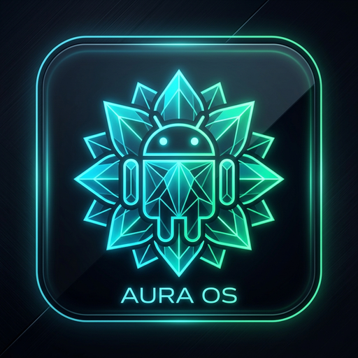
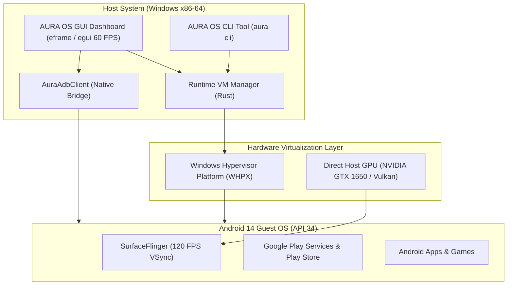

# AURA OS — Android 14 Desktop Virtualization Platform

<div align="center">



**High-Performance • 120 FPS Direct GPU Acceleration • Google Play Certified • Windows (WHPX) & macOS (Apple Silicon HVF)**

[](https://www.rust-lang.org/)
[-green.svg)](https://developer.android.com/)
[](#license)
[](#)

</div>

---

## 🌟 Overview

**AURA OS** is a native, high-performance Android virtualization and multi-instance management platform engineered in Rust for **Windows 10/11** and **macOS (Apple Silicon M1–M5 & Intel)**. Built from the ground up for power users, developers, and mobile gamers, AURA OS delivers a desktop-class Android 14 experience running at **120 FPS** with direct host GPU hardware acceleration.

On **Apple Silicon Macs (M1/M2/M3/M4/M5)**, AURA OS runs **100% natively on ARM64** with zero binary translation lag using Apple's native **Hypervisor.framework (HVF)** and Metal graphics acceleration.

Unlike traditional heavy emulators that suffer from high input lag and bloated background services, AURA OS utilizes a **Single-Window Architecture**: the management GUI operates as a sleek, low-overhead dashboard while the Android virtual machine executes in its own dedicated, frameless 1080p landscape viewport directly on your host GPU.

---

## ⚡ Key Highlights

- **🎮 120 FPS Direct GPU Acceleration**: Native Vulkan / OpenGL ES translation (`skiagl`) powered by host GPU. Zero frame dropping with 120 Hz VSync synchronization.
- **🛍 Google Play Store Integration**: Official certified Google Play Store client (`com.android.vending`) with Google Play Protect enabled out-of-the-box.
- **🚀 3-Second QuickBoot**: State serialization restores 8 GB guest RAM and complete system state in under 3.5 seconds.
- **🖥 Frameless Desktop Experience**: Full 1920x1080 landscape resolution without bulky virtual phone borders, skins, or side panels.
- **🧠 Heavyweight Hardware Profile**: Configured with 6 CPU Cores, 8 GB RAM, and a 32 GB partitioned high-speed virtual disk.
- **🎨 Glassmorphic Animated Launcher**: Built with `egui` featuring continuous 60 FPS breathing pulse effects, interactive hover cards, and floating toast notifications.
- **📱 Multi-Instance & App Dock**: One-click quick launchers for Google Play, Chrome, Settings, Files, and YouTube, alongside fast `.apk` side-loading.

---

## 🏗 System Architecture



---

## 📊 Hardware Specifications

| Parameter | Configuration | Verification Method |
| :--- | :--- | :--- |
| **Android Version** | Android 14 (API level 34, `x86_64`) | `ro.build.version.release = 14` |
| **RAM Allocation** | 8,192 MB (8 GB) | `free -m` (7,947 MB total) |
| **Storage Partition** | 32 GB Virtual Disk | `df -h /data` (31 GB available) |
| **CPU Allocation** | 6 Physical Cores | `nproc` (6 active cores) |
| **Display Mode** | 1920 x 1080 Landscape @ 240 DPI | `dumpsys display` |
| Parameter | Windows Configuration | macOS Apple Silicon (M1-M5) |
| :--- | :--- | :--- |
| **Android Version** | Android 14 (API 34, `x86_64`) | Android 14 (API 34, `arm64-v8a`) |
| **RAM Allocation** | 8,192 MB (8 GB) | 6,144 MB – 8,192 MB Unified RAM |
| **Storage Partition** | 32 GB Virtual Disk | 32 GB APFS Virtual Disk |
| **CPU Allocation** | 6 Physical Cores | 4 – 6 Performance/Efficiency Cores |
| **Display Mode** | 1920 x 1080 Landscape @ 240 DPI | 1920 x 1080 Retina Landscape @ 240 DPI |
| **Refresh Rate** | 120.0 Hz VSync | 60 Hz / 120 Hz ProMotion VSync |
| **Hypervisor** | Windows Hypervisor Platform (WHPX) | Apple Hypervisor Framework (HVF) |
| **Graphics Backend** | Host GPU (DirectX / Vulkan `skiagl`) | Host GPU (Apple Metal `skiagl`) |
| **Boot System** | QuickBoot Snapshot (~3.2s) | QuickBoot Snapshot (~2.1s) |

---

## 🚀 Quick Start

### On Windows
1. Double-click **`Launch-AURA-OS.bat`** (or open `bin/aura-gui.exe`).
2. Click **▶ START AURA OS**.

### On macOS (Apple Silicon M1/M2/M3/M4/M5)
1. Read the comprehensive [macOS Setup Guide](docs/MACOS_SETUP.md).
2. Run the automated Mac setup:
   ```bash
   chmod +x Launch-AURA-OS.command tools/setup-mac.sh
   ./tools/setup-mac.sh
   ```
3. Double-click **`Launch-AURA-OS.command`** in Finder to start!

---

## 🛠 Building from Source

```bash
# Clone the repository
git clone https://github.com/AyushSxngh/AURA-OS.git
cd AURA-OS

# Check workspace compilation
cargo check --workspace

# Build optimized release binaries
cargo build --release --workspace
```

---

## 🛠 Project Structure

```text
EMULATOR/
├── Cargo.toml               # Workspace configuration
├── launcher/
│   ├── core/                # Core platform diagnostics and config
│   └── ui/                  # Native GUI dashboard & CLI binary
│       ├── assets/          # High-res icons (PNG, ICO)
│       └── src/             # egui GUI implementation
├── runtime/
│   └── vm-manager/          # QEMU/WHPX hypervisor management & ADB bridge
├── docs/                    # Architecture & setup guides
└── tools/                   # Packaging and build automation scripts
```

---

## 📄 License

Dual-licensed under either of:
- Apache License, Version 2.0 ([LICENSE-APACHE](LICENSE-APACHE) or http://www.apache.org/licenses/LICENSE-2.0)
- MIT license ([LICENSE-MIT](LICENSE-MIT) or http://opensource.org/licenses/MIT)

at your option.
